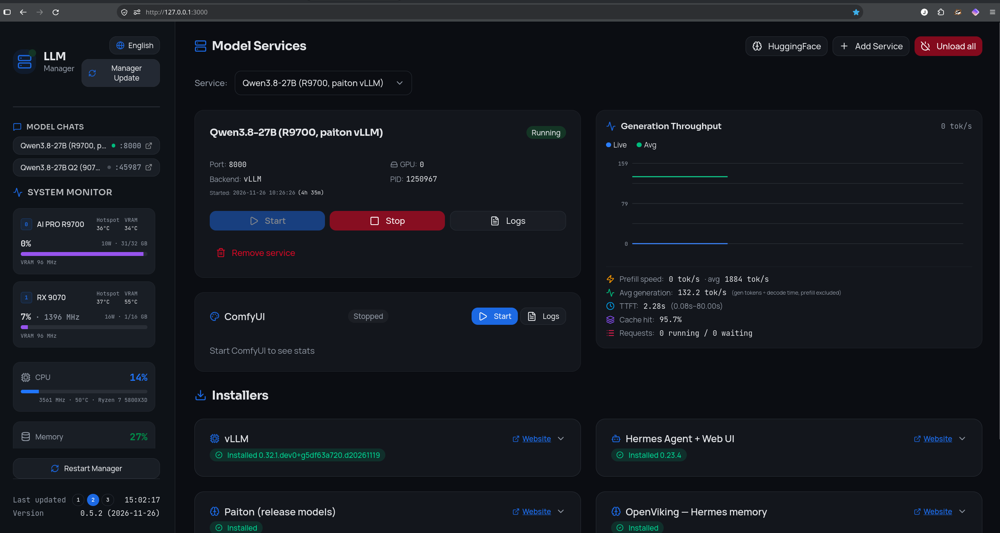
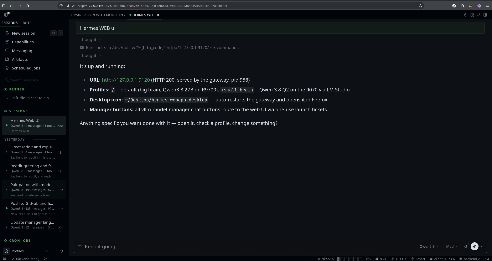

# LLM Manager

在自己电脑上运行 AI 模型的网页控制面板。用按钮启动/停止模型，实时查看 GPU 状态，在浏览器里和模型聊天，还能从同一个页面一键安装你需要的工具（vLLM、Hermes、ComfyUI）—— 无需打开终端。

<div align="center">

[]()
[]()
[](LICENSE)
[](https://github.com/shihaohou/vllm-model-manager-)

**[English](README.md)** | 简体中文

</div>

**[快速开始](#快速开始)** • [功能](#功能) •
[支持的后端](#支持的后端) • [故障排查](#故障排查) •
[开发者指南](#开发者指南)

---

## 截图

**管理器仪表盘** —— 模型服务卡片、实时系统监控、生成吞吐量，以及一键安装器：



**Hermes 网页界面** —— 管理器聊天按钮打开的 agent 工作区（会话、定时任务、配置文件和模型聊天）：



---

## 快速开始

三步：

```bash
git clone https://github.com/SliverFold/LLM-Manager.git
cd LLM-Manager
./setup.sh
```

然后在浏览器打开 **http://127.0.0.1:3000**。

就这样。`setup.sh` 会安装好一切（Python 环境、前端、以及让管理器持续运行的后台服务），完成后显示 "ready"。管理器会在电脑开机时自动启动。

**要求：** 带 systemd 的 Linux 系统、Python 3.8+、Node.js 18+、git，以及一块 GPU（NVIDIA 配 CUDA 或 AMD 配 ROCm）。不需要其他任何东西 —— vLLM、Hermes、ComfyUI 都可以从界面里直接安装（见下文）。

---

## 功能

### 启动、停止、监控你的模型

每个模型服务是一张卡片，带 **启动（Start）**、**停止（Stop）**、**日志（Logs）** 按钮，以及实时的 **运行中 / 已停止** 状态徽章。用 **全部卸载（Unload all）** 可以一次停止所有模型。左侧边栏是实时系统监控：每块 GPU 的显存、利用率、温度、功耗，以及 CPU、内存、磁盘。

### 和你的模型聊天

侧边栏的 **模型聊天（Model chats）** 列表可以为每个正在运行的模型打开一个简洁的浏览器聊天窗口 —— 无需额外配置。

### 添加新模型

点击 **添加服务（Add Service）**，选择后端（如 vLLM）、模型和要使用的 GPU。管理器会自动帮你找到模型（它会扫描你的模型目录）并自动生成启动/停止脚本。你也可以浏览文件系统，指向扫描没找到的模型。

### 一键安装工具

页面底部的 **安装器（Installers）** 区域可以安装：

- **vLLM** —— 高性能 LLM 推理引擎。安装器会自动为你的 GPU 选择正确的 wheel（AMD ROCm 或 NVIDIA CUDA）。AMD 用户还可以加装 Paiton 插件（提升量化模型性能），以及可选的 Qwen 工具（Qwen-Agent + Qwen Code，指向本地端点）。vLLM 卡片还有 **下载 vLLM 模型（Download a vLLM model）** 下拉菜单 —— 从精选的最新模型列表（Qwen 3.5/3.8、Gemma 4 等）中选择 Q4/4-bit 量化版本，一键下载。
- **Hermes Agent + Web UI** —— AI 助手及其浏览器工作区（端口 9120）。
- **OpenViking —— Hermes 记忆** —— Hermes 的长期记忆：OpenViking 服务器（端口 1934）、CPU 嵌入服务（bge-small-en-v1.5 GGUF 经 llama.cpp，端口 8091，零 VRAM）、Hermes 记忆插件以及 Hermes 记忆配置。全部以 systemd 用户服务运行，自动重启。
- **ComfyUI** —— AI 图像/视频生成框架。安装后，ComfyUI 卡片（服务区域下方）有 **启动（Start）** / **停止（Stop）** 按钮：启动时弹出 GPU 选择器让你选择运行在哪张卡上，**打开 UI（Open UI）** 在新标签页中打开 Web 界面。
- **LM Studio + Beledarian Suite** —— LM Studio 应用（任意 Linux 发行版）外加 Beledarian 工具箱（agentic AI 工具套件）。LM Studio 卡片还有 **下载 LM Studio 模型（Download an LM Studio model）** 下拉菜单 —— 从精选的 GGUF 模型列表（Qwen 3.5/3.8、Gemma 4 等）中选择 Q4 量化版本，一键下载。
- **Paiton（发布模型）** —— 以 Docker 容器方式运行任何 Paiton 发布模型：从下拉菜单中选择（Qwen3.8 27B（3-bit W3A4 或 MXFP4）、GPT-OSS 20B、MiniCPM5 2B、Ornith 1.5 35B、Qwen3-Coder 30B、Qwen3.8 NEO CODER MAX），安装器会拉取固定的 Paiton vLLM 镜像并启动服务器。需要 Docker 和 AMD GPU。

每张卡片显示该工具是否已安装，并有一个小的 **Website（网站）** 链接，点击后在新标签页中打开项目官网，安装前可以先看看这个工具是什么。

### 卸载工具

每张卡片都有一个 **卸载（Uninstall）** 按钮（带确认对话框），可以撤销安装：

- **vLLM** —— 移除 venv 及其包（勾选"删除 venv"可一并删除文件夹）。
- **Hermes** —— "卸载"会安全地禁用 webapp，不会移除正在运行的 agent。
- **OpenViking** —— 停止并移除服务器 + 嵌入服务以及 Hermes 插件，并重置 Hermes 记忆配置。除非勾选"删除记忆数据"，否则你的记忆数据（`~/.openviking`）会被保留。
- **ComfyUI** —— 移除 venv 及其包（勾选"删除 checkout"可一并移除包含自定义节点、输出和配置的 checkout）。
- **LM Studio + Beledarian Suite** —— 移除应用和 Beledarian Suite 克隆。你的模型（`~/.lmstudio/models`）和设置会被保留。

### 卸载管理器本身

要从系统中移除管理器（逆转 `setup.sh`），在仓库目录中运行：

```bash
./uninstall_manager.sh            # 停止 + 禁用服务，移除 units
./uninstall_manager.sh --remove-venv   # 同时删除 Python venv
```

这**不会**删除仓库本身（你的克隆、`config/` 和 `services.json`）—— 完全清除需手动删除文件夹。已安装的 AI 工具（vLLM venv、Hermes、ComfyUI、LM Studio）和你的模型绝不会被触碰。

---

## 支持的后端

| 后端 | 说明 |
|------|------|
| **vLLM** | 高性能 LLM 推理（大多数用户的首选） |
| **Ollama** | 流行的本地 LLM 运行器 |
| **LM Studio** | 带内置服务器的 GUI LLM 运行器 |
| **llama.cpp** | 轻量级 CPU/GPU LLM 推理 |

任何有启动/停止脚本和端口的服务都可以管理 —— 上面列出的后端有额外的集成（模型扫描、聊天等）。

> **注意：** 界面里的 **安装器** 覆盖 vLLM、Hermes 和 ComfyUI。Ollama、LM Studio、llama.cpp 受支持作为后端，但需要单独安装（LM Studio 是下载安装的软件，Ollama 是一条命令 —— 见它们的官网）。

---

## 故障排查

**页面白屏或样式丢失。**
前端构建没有完成静态资源拷贝。运行
`cd frontend && bash build.sh` 然后刷新页面。

**GPU 信息不显示。**
确认终端里能运行 `rocm-smi`（AMD）或 `nvidia-smi`（NVIDIA），且当前用户有权限运行。

**某个服务启动不了。**
先看该服务的 **日志** 按钮 —— 错误几乎都在里面。常见原因：端口已被占用、GPU 正被其他模型占用、模型路径错误。

**改了配置文件但没生效。**
管理器只在启动时读取 `config/services.json`。点击侧边栏底部的 **重启管理器（Restart Manager）**（或用 *添加服务* 对话框，它会自动重启）。

**改了配置后界面空白 / 显示旧的服务。**
同样 —— 点 **重启管理器**。

---

## 开发者指南

### 手动安装

```bash
pip install -r requirements.txt
cd frontend && npm ci && cd ..

# 构建前端（把静态资源拷进 standalone 包并重启前端服务 ——
# 不要直接运行 `npx next build`）
cd frontend && bash build.sh && cd ..
```

端点：**UI** 在 http://localhost:3000，**后端 API** 在
http://localhost:9000。

### systemd

`setup.sh` 安装两个 **用户级** 服务（`vllm-manager-backend`、
`vllm-manager-frontend`）并启用 linger，让它们在注销后继续运行。
仓库里也有系统级 unit（`vllm-manager-{backend,frontend}.service`），
如果你更喜欢 root 级服务。

```bash
systemctl --user status vllm-manager-backend
systemctl --user restart vllm-manager-frontend
```

### 配置

服务定义在 `config/services.json`（见
`config/services.json.example`）。每个条目：

```json
{
    "my-model": {
        "name": "我的模型",
        "port": 8000,
        "start_script": "/path/to/start.sh",
        "stop_script": "/path/to/stop.sh",
        "log_file": "/path/to/log.log",
        "process_pattern": "vllm serve.*MyModel",
        "gpus": [0]
    }
}
```

界面里的 **添加服务** 对话框会自动生成这样的条目。

### 后端 API（速查）

| 端点 | 用途 |
|------|------|
| `GET /api/services` | 所有服务 + 实时状态（运行/停止、PID、CPU、内存） |
| `POST /api/service/{key}/start` · `/stop` | 启动或停止服务 |
| `GET /api/service/{key}/logs?lines=200` | 最近的日志行 |
| `GET /api/gpu` | 每块 GPU 的信息（显存、利用率、温度、功耗） |
| `GET /api/system` | CPU / 内存 / 磁盘使用 |
| `GET /api/models` | 已安装模型扫描（HF 缓存、GGUF 目录、loader API） |
| `GET /api/models/browse?dir=/path` | 列出目录（手动选模型） |
| `GET /api/installer/status` · `POST /api/installer/{vllm,hermes,comfyui,lmstudio,openviking}` · `POST /api/installer/uninstall`（kind: vllm, hermes, comfyui, lmstudio, openviking） | 安装器 |
| `GET /api/comfyui/status` · `POST /api/comfyui/start`（body: `{"gpu": <index>}`）· `POST /api/comfyui/stop` · `GET /api/comfyui/logs` | ComfyUI 启动/停止 + 日志 |
| `GET /api/hermes/webapp-link?profile=<name>` | Hermes Web UI 的一次性链接 |

### 项目结构

```
LLM-Manager/
├── app.py                     # Flask 后端 (:9000)
├── installer.py               # 安装/卸载任务运行器
├── loaders/                   # 后端加载器 (vllm, ollama, lmstudio, llama_cpp)
├── frontend/                  # Next.js 前端 (:3000)
│   └── build.sh               # 构建 + 拷贝静态资源 + 重启服务
├── templates/                 # 每个模型的网页聊天
├── config/
│   ├── services.json          # 你的服务配置
│   └── platform.json          # 模型扫描目录 + 端口
├── scripts/                   # 生成的启动/停止 + 安装器脚本
├── setup.sh                   # 首次运行安装器
└── vllm-manager-*.service     # systemd unit（系统 + 用户模板）
```

---

## 贡献

欢迎提交 Issue 和 Pull Request —— 见
[Issues](https://github.com/SliverFold/LLM-Manager/issues)。

## 致谢

本项目是 [Hou Shihao](https://github.com/shihaohou) 的
[vllm-model-manager](https://github.com/shihaohou/vllm-model-manager-) 的 fork，
感谢原作者的出色工作。

## License

MIT —— 见 [LICENSE](LICENSE)。

## 更新日志

- 0.5.2 (2026-11-26)：模型下载器（vLLM + LM Studio，精选最新模型 Q4/4-bit 量化）、Paiton 发布模型安装器（任意模型，不仅 Qwen3.8）、恢复 fork-of 徽章。
- 0.5.1 (2026-11-26)：ComfyUI 启动/停止 + GPU 选择器、Open UI 按钮、OpenViking + LM Studio 安装器、LLM 管理器更新器。
